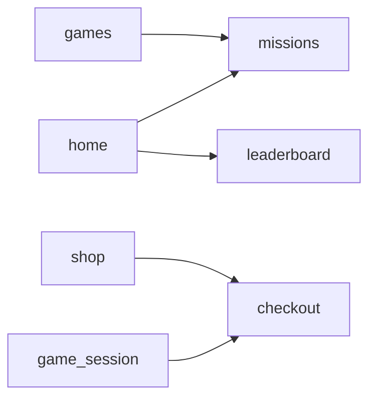

# MyGame P2E — Flutter Frontend Architecture

| Item | Value |
|---|---|
| Document | Flutter Frontend Architecture Specification |
| Version | 1.3 |
| Date | 2026-10-13 |
| Status | Approved for implementation. v1.3 closes the findings of the independent architecture audit (see §1.3). **OD-1 (hosting model) must be resolved before work on Router, Entry and Game Host is finalized.** New open decisions OD-10 to OD-12 are scheduled in §24. |
| Scope | Flutter frontend only. Backend internals, server databases and ledger design are out of scope. |
| Toolchain | Flutter **3.47.7** (stable) · Dart **3.13.x** (stable) |
| Sources | *MyGame P2E — MVP flow* (user-flow PDF, 11–12 Oct 2026), *MyGame P2E — complete wireframes v3* (Figma CSS export, 10 Oct 2026) |

---

## 1. Purpose

This document defines the frontend architecture of the MyGame Play-to-Earn application. It specifies:

- **what** the architecture is: structure, layers, modules and contracts
- **how** the team develops inside it: rules, conventions and quality gates
- **why** each decision was made, and which alternatives were rejected

The architecture aims for two things. The MVP must ship with as little complexity as possible. At the same time, the product must stay extensible for years: new features, new skins, tablet/web/desktop targets and new game types.

### 1.1 How to read this document

- **Rules** use *must* / *must not*. CI or code review enforces them.
- **Guidelines** use *should*. You may deviate if you have a stated reason.
- **Open decisions** use the IDs `OD-n` (see §24). Where an open decision affects a section, that section says so.

### 1.2 Changes in version 1.2

| Area | Change | Section |
|---|---|---|
| Pending financial operations | Persisted per user and **not deleted on logout**; suspended, hidden from other accounts, reconciled when the same user signs in again | §10.4, §12.3 |
| Retry policy | Automatic retry for reads only. Mutations are never retried automatically at any layer, including the API SDK | §10.6, §13.3 |
| Checkout API | Coordinator provider instead of a `WidgetRef` function. New `CheckoutHost` presents payment UI above the shell and the game | §11.5, §12.1 |
| Multi-entry destinations | Screens reachable from several tabs are root-level routes | §11.2 |
| Game session layout | "Full screen" means no shell and no system bars, but the host HUD stays. Mission context comes from the session-start response | §16.2, §18.2, §18.5 |
| IPG during a game | Purchase via the bank gateway from inside a game session is an explicit scenario with a mandatory test | §12.3, §18.5, §21 |
| Phase 0 exit criteria | Bridge security baseline must pass before any real game is connected | §21 |
| Header & avatar menu | Items pointing to *Coming soon* modules are flag-controlled; "Exit P2E" goes through `app/host` | §6.1, §19.5 |
| Open decisions | OD-7 extended with dark-mode designs; new OD-9 (Home MVP content) | §8, §24 |

### 1.3 Changes in version 1.3 (audit remediation)

Every change below is a local correction of a contract or rule. No module was added or removed, and the feature graph (§8) is unchanged.

| Audit ID | Area | Change | Section |
|---|---|---|---|
| ARCH-001 | Session teardown | `SessionScope` stays in `shared/session`. The `SessionTeardown` orchestrator moves to `app/lifecycle` because it must call features. Features expose teardown hooks in their public APIs. Added a push-token unbind step. | §6.1, §10.4 |
| ARCH-002 | Checkout | "Top up instead" (K03 → W04) is a top-up **leg inside the same checkout process**, not a second `start`. Top-up request accepts a pack or a shortfall amount. Added quote expiry and re-quote. | §12.1, §12.3 |
| ARCH-003 | Startup & entry | Startup gates are derived from shared read models; `entry` reports progress by mutating them. New `shared/profile` read model (current profile). Gates can re-open at runtime. Offline cold-start rule. | §6.1, §11.3 |
| ARCH-004 | Routing | Rules for Coin packs (P02) as a destination, back stack after deep links, chrome of root-level routes on tablet, and the per-game leaderboard. | §11.2 |
| ARCH-005 | Push | Ownership of permission state, token registration/unregistration and tap routing. | §17.4, §11.4, §6.1 |
| ARCH-006 | Checkout over game | Back-button priority, own `Overlay` for `CheckoutHost`, and a Phase 0 spike item. | §11.5, §18.5, §21 |
| ARCH-007 | Streak prompt | Trigger and ordering rules for the "first open today" prompt (H04). | §11.3 |
| ARCH-008 | Traceability | Added the PDF ↔ CSS ID crosswalk and the list of missing wireframes. | Appendix C, §2.1, OD-12 |
| ARCH-009 | Feature flags | General rule for non-MVP elements inside MVP screens, plus an inventory. | §19.5 |
| ARCH-010 | Scope confirmation | Dark mode and tablet are marked as *to be confirmed*. Golden matrix reduced until confirmed. | §2.3, §2.4, §19.1, OD-7 |
| ARCH-011 | Minor gaps | Session-state transitions, X04 "Not now", account deletion, redeem decision, scope enforcement test, pending claims, Switch/Checkbox/Radio. | §18.3, §14.2, §6.1, §10.4, §10.5, §15.3, §24 |

---

## 2. Product Context (Frontend View)

### 2.1 Source of truth

| Source | Role |
|---|---|
| **User flow (PDF)** | Defines **MVP scope**, navigation, entry gates, decisions, error/recovery states and items marked *Coming soon*. |
| **Wireframes v3 (CSS)** | Defines the **UI of the full product**: 113 phone screens (390 pt wide), layout archetypes, repeated components and overlay types. It also contains features beyond the MVP. |

Scope comes from the flow. Visual structure comes from the wireframes. If a wireframe screen shows non-MVP elements, those elements are not built until the flow brings them into scope.

**Screen IDs.** The flow (PDF) is canonical for IDs in this document. The wireframe export (10 Oct) predates the flow (11–12 Oct) and numbers the E-series differently; some flow screens have no wireframe yet. Appendix C maps the two and lists the gaps (OD-12).

### 2.2 MVP modules (from the user flow)

| # | Module | Frontend feature(s) |
|---|---|---|
| 1 | Entry, consent & onboarding | `entry` |
| 2 | Home & navigation | `home`, `app/shell` |
| 3 | Missions & quests (incl. daily streak, Lucky Wheel) | `missions` |
| 4 | Games (20 HTML5 games) | `games`, `game_session` |
| 5 | In-game purchase (P2E SDK) | `game_session`, `checkout` |
| 6 | Gaming Wallet & payments (Coins, IPG, DCB, Coins + IPG/DCB) | `wallet`, `checkout`, `shared/balance` |
| 7 | Shop (Coin packs only) | `shop` |
| 8 | Profile & settings | `profile` |
| 9 | Leaderboard (weekly overall, per game) | `leaderboard` |
| 12 | System & recovery states | `app/system` |

Modules 10 (Content) and 11 (Notifications & Support) are *Coming soon* and are not part of the MVP.

### 2.3 Target platforms

| Platform | Status |
|---|---|
| Android phone, iPhone | **MVP** |
| Android tablet, iPad | **MVP (to be confirmed).** Neither the flow nor the wireframes mention tablets; the wireframes are phone-only (OD-7). |
| Web | Not prioritized. Architecture must keep it **possible** (§17.3). |
| Desktop (macOS / Windows / Linux) | Future. Not designed for in the MVP. |

### 2.4 Key product facts that shape the frontend

- **Bilingual:** Persian (RTL) and English (LTR). Prices are in Toman and dates use the Jalali calendar (wireframes N06, W03, M03).
- **Theme:** Light, Dark and System, switchable by the user. *To be confirmed:* the settings wireframe (N06) has no theme row and no dark designs exist (OD-7). The mechanism is cheap and stays; the settings switch and dark goldens follow the confirmation. The architecture must allow more skins later.
- **HTML5 games run inside the app** and talk to it through the P2E SDK (`P2E.init`, events, `P2E.purchase`).
- **Payments** go through bank gateway (IPG) and carrier billing (DCB). Card data is never entered inside the app.
- **Server-side decisions:** the server decides balances, mission progress, caps, purchase results and leaderboard ranks. The client displays them and never computes them.
- **Backend communication goes through an API SDK** provided by the backend team (§13).

---

## 3. Toolchain

| Tool | Version / Policy |
|---|---|
| Flutter | **3.47.7 stable**, pinned per repository (e.g. FVM `.fvmrc`) and used identically on every developer machine and in CI. |
| Dart | **3.13.x**, the version bundled with the pinned Flutter. `pubspec.yaml`: `environment: sdk: ^3.13.0`. |
| Upgrade policy | Upgrade Flutter only through a dedicated PR that runs the full test and golden suite. No floating channel. Patch upgrades are allowed at any time. Minor upgrades happen once per quarter at most, and never during a release freeze. |
| Package versions | Pin all dependencies with caret constraints. Commit `pubspec.lock`. Review dependency upgrades monthly. |

**Rationale:** with pinned versions, every developer, golden test and CI build renders the same output. Golden tests fail across Flutter versions because rendering details change between releases.

---

## 4. Architectural Principles

1. **Feature-first.** Code is organized by product capability, not by technical type. Teams can then work on features in parallel.
2. **Two levels.** A product-agnostic **Foundation** (`core/`, `ui/`, platform policies) sits under the **Product** level (`shared/`, `features/`). Foundation code knows nothing about Coins, Missions or MCI.
3. **Explicit boundaries over folders.** A folder is not a boundary. Import rules enforced in CI are (§9).
4. **Public API per feature.** A feature exposes one file. Everything else is private.
5. **No abstraction without a second implementation or a test seam.** Interfaces exist only where real alternatives exist, such as platform capabilities, WebView and host integration.
6. **Server is the source of truth.** The client shows server decisions and does not duplicate business rules.
7. **Three independent axes of variation.** Skin/brightness (look), size class (layout) and platform (behavior/capabilities) are each resolved once and consumed from context. Features never branch on OS, device type or theme name.
8. **Build for MVP, design for extension.** Add mechanisms that are cheap now and expensive to retrofit later: tokens, RTL, size classes, platform policy and session scope. Defer everything else.
9. **No empty scaffolding.** Create a folder only when its first file is needed.

---

## 5. Architecture Overview

### 5.1 Levels and layers

```
┌──────────────────────────────────────────────────────────────┐
│ app/            Composition root: bootstrap, router, shell,  │
│                 startup, system states, platform, host       │
├──────────────────────────────────────────────────────────────┤
│ features/       Product features (entry, home, missions,     │  PRODUCT
│                 games, game_session, checkout, wallet, ...)  │  LEVEL
├──────────────────────────────────────────────────────────────┤
│ shared/         MyGame-specific shared ownership: session,   │
│                 balance, backend adapter, money, formatting  │
╞══════════════════════════════════════════════════════════════╡
│ ui/             Design System: tokens, theme, adaptive,      │  FOUNDATION
│                 components, overlays, patterns               │  LEVEL
├──────────────────────────────────────────────────────────────┤
│ core/           Infrastructure: errors, diagnostics,         │
│                 storage, connectivity, async, time           │
└──────────────────────────────────────────────────────────────┘
         Dependencies point downward only (see §9).
```

`app/` holds both foundation mechanisms (router setup, platform policy, adaptive shell) and product wiring (startup gates, tab definitions). It is the only layer allowed to know every other layer.

### 5.2 Why a single Flutter package (not multiple packages)

| Option | Decision |
|---|---|
| Single app package + CI-enforced import rules | **Chosen.** One product, one team. Lowest friction. Boundaries are still enforced. |
| Melos / pub workspace with `foundation` and `design_system` packages | Deferred. Extract when a second app consumes the Foundation, or when white-label builds need compile-time isolation. The folder layout makes extraction mechanical. |
| Package per feature | Rejected for MVP. High overhead in analyzer config, versioning and build times, with no benefit at the current scale. |

---

## 6. Project Structure

```
mygame_p2e/
├── .fvmrc                         # pinned Flutter 3.47.7
├── pubspec.yaml
├── analysis_options.yaml          # lints (§19.2)
├── config/                        # dev.json · stage.json · prod.json (dart-define files)
├── tool/
│   └── check_architecture.dart    # import rules + banned widgets (CI gate)
├── assets/
│   ├── fonts/                     # bundled Persian + Latin fonts
│   ├── images/                    # product illustrations
│   └── icons/
├── l10n/                          # app_fa.arb · app_en.arb
├── lib/
│   ├── main.dart
│   ├── app/
│   │   ├── bootstrap.dart
│   │   ├── app.dart
│   │   ├── config/
│   │   ├── router/
│   │   ├── startup/
│   │   ├── shell/
│   │   ├── system/
│   │   ├── lifecycle/
│   │   ├── platform/
│   │   └── host/
│   ├── core/
│   │   ├── errors/
│   │   ├── diagnostics/
│   │   ├── storage/
│   │   ├── connectivity/
│   │   ├── async/
│   │   └── time/
│   ├── ui/
│   │   ├── tokens/
│   │   ├── theme/
│   │   ├── adaptive/
│   │   ├── components/
│   │   ├── overlays/
│   │   └── patterns/
│   ├── shared/
│   │   ├── backend/
│   │   ├── session/
│   │   ├── profile/
│   │   ├── balance/
│   │   ├── preferences/
│   │   ├── navigation/
│   │   ├── money/
│   │   ├── formatting/
│   │   └── widgets/
│   └── features/
│       ├── entry/
│       ├── home/
│       ├── missions/
│       ├── games/
│       ├── game_session/
│       ├── checkout/
│       ├── wallet/
│       ├── shop/
│       ├── profile/
│       └── leaderboard/
├── test/                          # mirrors lib/
├── integration_test/
└── test_fixtures/
    └── fake_game/                 # HTML5 page implementing the P2E SDK for bridge tests
```

### 6.1 Responsibilities

#### `app/` — composition root

| Folder | Responsibility | Why it exists |
|---|---|---|
| `bootstrap.dart` | Initialization order: config → diagnostics → storage → `ProviderScope` → `runApp`. | One place controls startup order and failure handling. |
| `app.dart` | `MaterialApp.router`: `theme`, `darkTheme`, `themeMode`, locale and delegates. Mounts root-level hosts such as `CheckoutHost` (§12.1) above the shell and the game route. | Single root widget. |
| `config/` | `AppConfig` (environment values from dart-define), feature flags, minimum supported version. | Environment differences without code changes (§19.4). |
| `router/` | `GoRouter` setup, `StatefulShellRoute`, assembly of feature route lists, redirects, deep links. | Navigation is cross-cutting. Features contribute routes, and `app/` assembles them (§11). |
| `startup/` | `StartupController` state machine and the X01 loading screen. | Entry gates live in one testable state machine instead of being scattered across screens (§11.3). |
| `shell/` | `AdaptiveScaffold`: header (avatar, nickname, Points, Coins with top-up, alerts, help), bottom navigation or rail, avatar menu (H03). Header and menu items that lead to *Coming soon* modules (alerts → inbox, help → support, friends, clan, content, inventory) are controlled by feature flags (`hidden` / `teaser`). "Exit P2E → MyGame" goes through `app/host`. | Shared chrome around the five tab roots. |
| `system/` | Global states X02, X04, X05 and X07, the offline banner host, and the error-scope policy. | Global reactions belong to the app, not to features (§14). |
| `lifecycle/` | App lifecycle observer: resume refresh and reconciliation of pending operations. Also hosts the `SessionTeardown` orchestrator (§10.4), because teardown must call several features. | One owner for foreground/background behavior and for cross-feature session cleanup. |
| `platform/` | `PlatformBehavior`, `PlatformCapabilities`, platform adapters, and the push lifecycle: OS permission state, token registration/unregistration, notification-tap routing (§17.4). | The only place allowed to inspect the OS (§17). |
| `host/` | `HostIntegration`: entry from MyGame/My MCI, SSO handoff, "Exit to MyGame". | Isolates the unresolved hosting model (OD-1). |

#### `core/` — infrastructure (product-agnostic)

| Folder | Responsibility |
|---|---|
| `errors/` | `AppFailure` sealed hierarchy, `ErrorScope`, `Result` helpers. |
| `diagnostics/` | Logger facade, crash-reporter facade, PII redaction (phone numbers, tokens). |
| `storage/` | `KeyValueStore`, `SecureStore`, `CacheStore`, namespaced per user (§10.5). |
| `connectivity/` | Online/offline stream. |
| `async/` | `SingleFlight` (in-flight de-duplication), debounce, throttle. |
| `time/` | `ServerClock`: server time offset for countdowns and resets. |

#### `ui/` — Design System (product-agnostic)

| Folder | Responsibility |
|---|---|
| `tokens/` | Primitive and semantic tokens: color, typography, shape, spacing, motion. Each set is defined per skin × brightness. |
| `theme/` | `AppThemeFactory.build(skin, brightness)` → `ThemeData` + `ThemeExtension`s. Context accessors (`context.tokens`). |
| `adaptive/` | `SizeClass`, `PageScaffold`, `AdaptiveGrid`, content-width rules. |
| `components/` | `AppButton`, `AppTextField`, `AppOtpField`, `AppChip`, `AppTabs`, `AppSwitch`, `AppCheckbox`, `AppRadio`, `AppCard`, `AppListItem`, `AppAvatar`, `AppBadge`, `AppProgress`, … |
| `overlays/` | `AppSheet` (sheet on compact, dialog on larger widths), `AppDialog`, `AppSideMenu`, `AppToast`. |
| `patterns/` | `StatusPage` (result/flow pages), `SectionError`, `EmptyState`, `Skeleton`, `OfflineBanner`. |

`ui/` must not depend on Riverpod, `shared/` or `features/`. It is plain Flutter.

#### `shared/` — product-level shared ownership

| Folder | Responsibility |
|---|---|
| `backend/` | API SDK adapter: SDK instance per environment, token provision, SDK error → `AppFailure` mapping (§13). |
| `session/` | Authenticated session state, `SessionScope`, and the gate read models for session validity and terms/consent status (§11.3). It knows no feature. The teardown orchestrator lives in `app/lifecycle` (§10.4). |
| `profile/` | `currentProfileProvider`: the P2E profile of the signed-in user (nickname, avatar, "profile exists"). Read by the shell header, startup gates, `profile` and `entry`. Read model only, no UI. Admitted under the rule below: no natural single owner, stable contract, used by `app/shell`, `entry` and `profile`. |
| `balance/` | Points and Coins read model (`balanceProvider`, `BalanceRepository`). Used by the shell, wallet, checkout, missions and leaderboard. Has no UI. |
| `preferences/` | User preferences: theme mode and language. Settings (N06) writes them. Also local gate flags: onboarding seen, push prompt asked. |
| `navigation/` | `AppLocations`: typed location builders (paths only, no widgets). |
| `money/` | `Points`, `Coins`, `Toman` value types and formatters. |
| `formatting/` | Jalali dates, durations, countdowns, localized digits. |
| `widgets/` | Product widgets used by several features: `CurrencyChip`, `RewardPill`, `OnlineOnlyAction`. |

**Admission rule for `shared/`.** Code enters `shared/` only if **all three** conditions hold:

1. No feature is its natural owner.
2. Its contract is stable.
3. At least two features use it.

Otherwise it stays in the owning feature's public API. Example: `StreakCard` stays in `missions` even though `home` displays it.

#### `features/`

| Feature | MVP screens (flow IDs) | Owns |
|---|---|---|
| `entry` | E01–E04, E06, E07, E08, E10, E11 | Onboarding, My MCI sign-in/OTP, terms & consent, profile creation, push pre-prompt. Reports progress by updating the gate read models in `shared/` (§11.3); it never calls `app/startup`. |
| `home` | H01, H02 | Home composition only. Holds no domain data of its own. |
| `missions` | M01–M03, M05, M06, M08, M09, M11, M12, M13, M18, H04 | Mission hub, detail, progress, claim, quest chains, daily streak, Lucky Wheel |
| `games` | G01–G03 | Catalog, search & filter, game detail |
| `game_session` | G04, G05, G06, G08, G09 | HTML5 game runtime, P2E SDK bridge, session lifecycle, round summary (§18) |
| `checkout` | K02–K08, W04–W06, W08–W10 | Payment process: Coins, IPG, DCB, mixed payments, pending/failed/success (§12.3) |
| `wallet` | W01–W03 | Wallet overview, transaction history, transaction detail. W12–W14 (redeem) are pending a product decision. |
| `shop` | P02 | Coin packs. Reached from the Shop tab, from Wallet *Top up* and from the header Coins chip (rule in §11.2). |
| `profile` | S01, S02, N06, S15 | Profile, edit profile, settings, account & data. S15 *Log out* and a server-confirmed *Delete P2E account* both end in `SessionTeardown`. *Download my data* is a server-side request; the client only starts it and shows its status. |
| `leaderboard` | L01, L02, L04–L07 | Weekly overall board, per-game boards, filters, player summary, week results, rank report |

Wireframe IDs are references only. They must not appear in class, file or route names (§20).

---

## 7. Feature Module Standard

### 7.1 Template

```
features/<feature>/
├── <feature>.dart                 # PUBLIC API — the only file other modules may import
└── src/
    ├── data/                      # repositories → API SDK; SDK model → feature model mapping
    ├── domain/                    # OPTIONAL: feature models and client-side rules (pure Dart)
    └── presentation/
        └── <flow_or_screen>/      # grouped by screen/flow, not by file type
            ├── <name>_screen.dart
            ├── <name>_controller.dart
            └── widgets/
```

### 7.2 Rules

- The public API file exports only:
  - the feature's route list
  - providers that other modules are allowed to read
  - widgets that other modules are allowed to embed
  - request/result functions for processes (§12)
- `src/` is private. No other module imports from it.
- `domain/` is **optional**. Create it only when the feature has its own models or rules. Most MVP rules are decided by the server.
- **Repositories are concrete classes.** No interface by default. Tests override providers instead of injecting abstractions.
- **SDK types stay in `data/`.** Repositories return feature models. Presentation never sees SDK or transport types.
- **Use cases are not mandatory.** Add a use-case/coordinator class only when logic spans several repositories or a multi-step process (e.g. checkout).
- **Group presentation by flow** (`hub/`, `detail/`, `wheel/`), not by type (`screens/`, `controllers/`). Code that changes together stays together.

---

## 8. Allowed Feature Graph



- Features with no outgoing edges: `entry`, `missions`, `checkout`, `wallet`, `leaderboard`, `profile`.
- **Home content follows the user flow:** daily streak, Lucky Wheel and rank snapshot. Wireframe H01 also shows sections such as *Continue mission*, *Featured games* and a shop preview. If the product keeps *Featured games* in the MVP, add the edge `home → games` (OD-9).
- **`game_session` does not depend on `missions`.** The mission context shown during a game (G05, G06 HUD, G09) comes from the session-start and session-end responses (§18.2).
- **Every feature** may depend on `shared/`, `ui/` and `core/`.
- **Navigation is not a dependency.** Navigating to another feature uses `AppLocations` and creates no import edge.
- **Teardown hooks are not graph edges.** `SessionTeardown` lives in `app/` and calls hooks that each feature exports from its public API (§10.4).
- **Gate progress is not a graph edge.** `entry` updates read models in `shared/` (`session`, `profile`, `preferences`); `app/startup` reads them (§11.3).
- **Streak prompt (H04).** `home` reads a prompt provider exported by `missions`, using the existing `home → missions` edge (§11.3).
- The graph must remain **acyclic**. Adding an edge requires an architecture review.

---

## 9. Dependency Rules

### 9.1 Layer matrix

| From ↓ / may import → | `core` | `ui` | `shared` | other feature public API | `app` |
|---|---|---|---|---|---|
| `core` | — | ✗ | ✗ | ✗ | ✗ |
| `ui` | ✗ | — | ✗ | ✗ | ✗ |
| `shared` | ✓ | ✓ | — | ✗ | ✗ |
| `features/*` | ✓ | ✓ | ✓ | ✓ only edges in §8 | ✗ |
| `app` | ✓ | ✓ | ✓ | ✓ | — |

### 9.2 Within a feature

`presentation → domain, data (via providers)` · `data → domain, shared/backend, core` · `domain → nothing` (pure Dart).

### 9.3 Forbidden

- Any import of `features/home` from another module.
- Importing `features/<x>/src/**` from outside feature `<x>`.
- API SDK imports outside `features/*/src/data/` and `shared/backend/`.
- `dart:io` or `Platform.isX` outside `app/platform/` and `core/`.
- Raw colors, font sizes or radii in `features/` or `shared/widgets/`. Tokens only.
- Banned visual widgets in `features/` (§15.3).
- A global event bus.

### 9.4 Enforcement

`tool/check_architecture.dart` runs in CI and fails the build when it finds:

- forbidden imports (path-based rules from §9.1–9.3)
- banned widget usage in `features/`
- `dart:io` usage outside allowed folders

**Rationale:** a 100-line script is cheaper and more transparent than a plugin framework, and it gives the same guarantees.

---

## 10. State Management

### 10.1 Choice: Riverpod 3 with code generation

| Option | Assessment |
|---|---|
| **Riverpod 3 + `riverpod_generator` + `riverpod_lint`** | **Chosen.** One mechanism covers DI, async state, caching and test overrides. Compile-safe. Auto-dispose by default. |
| Bloc/Cubit | Strong for explicit, auditable event flows. More boilerplate and a second DI mechanism. |
| Provider + ChangeNotifier (official MVVM guide) | Simple, but no built-in async lifecycle, caching or scoping. |

Use only one state-management style in the codebase. `get_it` and other service locators are not used.

### 10.2 Provider kinds

| Use case | Provider kind |
|---|---|
| Services, repositories, derived/computed values | Functional provider (`@riverpod` function returning a value) |
| Read-only async data without commands | Functional provider returning `Future` / `Stream` |
| State with commands/mutations | Class provider: `Notifier` / `AsyncNotifier` |
| **Forbidden** | `StateProvider`, `StateNotifierProvider`, `ChangeNotifierProvider` (legacy in Riverpod 3) |

### 10.3 Lifetime

- **Default: auto-dispose.** Screen state lives as long as a widget listens to it.
- **`keepAlive` is allowed only for:** session, config, preferences, balance and current profile.
- **Ephemeral UI state** (text controllers, animation controllers, local toggles) stays in `StatefulWidget`. `flutter_hooks` is not used.

### 10.4 Session scope and account switching

User-specific state must not leak between accounts. Two mechanisms handle this:

1. **`SessionScope`** (`shared/session`) exposes `userId` and `sessionEpoch`. Every user-specific provider watches it. When the session changes, those providers rebuild, including `keepAlive` ones.
2. **`SessionTeardown`** (`app/lifecycle`) runs on logout, account deletion or account change. It lives in `app/` because it must call features, and `shared/` must not import them (§9.1). It clears what providers cannot clear by themselves, in this order:
   1. Cancel in-flight requests (`shared/backend`).
   2. End any active game session (hook exported by `game_session`).
   3. Clear WebView data: cookies, local storage (hook exported by `game_session`).
   4. Unbind the push token on the backend and locally (`app/platform`, §17.4). Best effort, and retried at the next sign-in if it fails. It runs while the user's credentials are still valid.
   5. Delete the user's persisted cache namespace (`core/storage`).
   6. **Suspend** the user's pending operations (hook exported by `checkout`): stop processing them, keep them persisted in the user's namespace, and make them invisible to any other account. They are **never deleted by logout** (§12.3).
   7. Advance the session epoch.

   **Teardown hooks.** A feature that holds user-private state exports one hook from its public API (§7.2). `app/lifecycle` composes the hooks in the order above. A new feature with private user state must add its hook and a test (see below).

**Pending financial operations are not cache.** A pending IPG/DCB payment (or a reward claim, if that flow is ever introduced) is a pointer to a server-side operation. Deleting it locally could lead the user to pay again (W03: "Don't pay again — a second payment would be a separate charge"). Rules:

- They are stored per `userId` in `SecureStore` / `KeyValueStore`, separately from the cache namespace.
- They are visible and processed only while the same user is signed in.
- When that user signs in again, they are reconciled with the server.
- If a pending payment exists at logout, the user sees a warning before confirming.
- They are removed only when the server reports a final state (success, failed, cancelled) or the server no longer knows the operation.
- The server-side pending list (W01 *Pending*, W02 history) remains the source of truth. The local record exists to correlate the bank-gateway return with its operation.

**Mandatory tests:**

- Switch between two accounts without restarting the app. Verify that no data from the previous account is visible or cached.
- Log out with a pending payment, sign in with another account, then sign back in with the first account. Verify that the pending payment is hidden from the second account and reconciled for the first.
- **Scope enforcement test.** In a `ProviderContainer`, bump the session epoch and verify that each user-specific provider exported for tests by its feature is rebuilt. `SessionScope` relies on every user-specific provider watching it, and this test is the guard. If it finds leaks that are hard to fix, the fallback is to recreate the root `ProviderScope` after teardown.
- **Timing.** Run the account-switch tests as soon as the first teardown hook exists (Phase 5 for `game_session`, Phase 6 for `checkout`), not only in Phase 9.

### 10.5 Cache ownership

| Layer | Owns |
|---|---|
| Providers | In-memory state. |
| Repositories | Persisted cache only (for offline read-only mode, X03), namespaced by `userId`. Deleted on logout. |
| `checkout` coordinator | Pending payment operations (§10.4). Not cache; never deleted on logout. `missions` has no pending operations in the MVP (M07 *Reward held* is *Coming soon*); add them only if that flow enters scope. |

Offline writes are not supported in the MVP. Mutations require a connection.

### 10.6 Retry and refresh

Reads and writes follow different rules.

| Operation type | Examples | Automatic retry |
|---|---|---|
| **Read** (safe, no side effects) | Game catalog, mission list, leaderboard, balance, transaction history | Allowed. Retry `network` and `timeout` failures with backoff. Never retry `unauthorized`, `forbidden`, `validation` or `business`. |
| **Mutation** (changes server state) | Purchase, top-up, claim reward, spin the wheel, accept terms, update profile | **Never automatic, at any layer.** |

Rules:

- **Provider `build()` methods are read-only.** Mutations happen only in `Notifier` / `AsyncNotifier` methods. Riverpod 3 retries automatically only when a provider fails during initialization, so this rule keeps mutations out of the retry path.
- Configure the global retry on `ProviderScope` with the read policy above.
- **The API SDK must not retry mutations** (POST/PUT/PATCH/DELETE). If it does by default, `shared/backend` disables it (OD-2).
- **No double retry for reads.** If the SDK already retries reads, disable provider retry for SDK calls.
- **A mutation is repeated only by an explicit user action** (e.g. *Try again* on K07 or W09) and always with the **same `requestId`**. A `requestId` makes a repeat safe only if the backend guarantees idempotency for that operation (OD-2). Until that is confirmed, *Try again* first checks the operation's status on the server.
- **On resume**, only these are refreshed: balance, active game session state, pending operations and screens whose data has passed its staleness threshold.

---

## 11. Navigation

### 11.1 Choice: `go_router`

| Option | Assessment |
|---|---|
| **`go_router` + `StatefulShellRoute.indexedStack`** | **Chosen.** Official package, declared feature-complete and in stability/bug-fix mode. URL-based (good for deep links and future web). Preserves tab state. |
| `auto_route` | More features and code generation. A larger third-party surface. |
| Navigator 2.0 directly | Too low-level for the team's needs. |

### 11.2 Route categories

| Category | Navigator | Examples |
|---|---|---|
| **Tab roots** | Shell branches (state preserved) | Home, Missions, Games, Leaderboard, Shop |
| **Branch details** | Declared under the owning branch path, so back stack and deep links are correct. Used only for screens reachable from **one** tab. | Mission filter results, quest chain, player summary, week results, rank report |
| **Multi-entry destinations** | Root-level routes, shown above the shell | Wallet (avatar menu, M08 *View wallet*, leaderboard rewards), game detail (Home, Games, Missions *Play*), mission detail (Home, Missions, game detail), profile, settings |
| **Full-screen flows** | Root navigator | Entry flow, game session, checkout results, system pages |

**Rule:** if a screen can be opened from more than one tab, it is a root-level route. Otherwise it is a branch detail. This matches the wireframes, where these screens have no tab bar.

**Navigation chrome is a behavior decision, not a route decision, for branch details.** On compact widths, `AdaptiveScaffold` hides the bottom bar on non-root branch locations (as in the wireframes). On tablet it keeps the navigation rail visible. Routes do not change between form factors.

**Root-level routes sit above the shell**, so they show no tab bar and no rail on any size class. Until tablet designs exist (OD-7), this is the default. A tablet design may change it by wrapping root-level routes in the adaptive scaffold; no route changes are needed for that.

**Additional rules (v1.3):**

- **Leaderboard.** The wireframe L02 keeps the header and tab bar, and L01/L02 are segments of one screen (*General | Per game*). The Leaderboard tab root hosts both segments. The segment is state of the tab, not a route. L04 is a sheet. Player summary (L05), week results (L06) and rank report (L07) are branch details.
- **Coin packs (P02) as a destination.** P02 is the root of the Shop tab and also the target of Wallet *Top up* (W01) and of the header Coins chip. `AppLocations.coinPacks()` always resolves to the Shop tab. When it is opened from a root-level route such as the Wallet, the root-level route is closed first, so Wallet is not left on the stack behind the tab. After a successful top-up the result screen offers *View wallet*. This follows the wireframe, where P02 has the tab bar and header. A design change can replace the rule with a root-level route that reuses the same screen.
- **Back stack after a deep link.** A root-level route opened from a deep link, push or campaign link has no parent. The router guarantees that Back from such a route lands on the Home tab root and never leaves the app while Home is available. The same rule applies after a deferred destination is restored.

### 11.3 Startup state machine

`StartupController` produces a `StartupState`. The router's `redirect` reads only that state. The controller holds all the gating logic and is unit-tested without UI.

```
initializing
  → versionCheck ──(unsupported)──────────────────→ updateRequired (X07)
  → firstLaunchOnboarding ─(not seen)─────────────→ onboarding (E01–E04)
  → sessionCheck ──(no valid My MCI session)──────→ signIn (E06)
  → termsCheck ────(not accepted / declined)──────→ consent (E07 / E08)
  → profileCheck ──(no P2E profile)───────────────→ createProfile (E10)
  → pushPrePrompt ─(not asked yet)────────────────→ pushPrompt (E11)
  → loading (X01) ─(failure)──────────────────────→ safeError (X02)
  → ready → Home (H01)
```

The exact order and the SSO behavior depend on **OD-1**.

**Gate contract (v1.3).**

- `StartupController` derives its state **only from read models**. It is never called by features. The read models per gate are:

| Gate | Read model | Updated by |
|---|---|---|
| versionCheck | Minimum version from remote config (§19.5) | `app/config` |
| firstLaunchOnboarding | `onboardingSeen` flag (`shared/preferences`) | `entry` |
| sessionCheck | Session validity (`shared/session`) | `entry` (sign-in), `shared/backend` (expiry) |
| termsCheck | Terms/consent status and accepted version (`shared/session`) | `entry` |
| profileCheck | `currentProfileProvider` (`shared/profile`) | `entry` (E10), `profile` (S02) |
| pushPrePrompt | `pushPromptAsked` flag (`shared/preferences`) | `entry` |

- A feature that completes a gate step performs its mutation and refreshes the matching read model (§12.2). The controller reacts. Nothing calls `app/startup` and nothing imports `app/` from a feature (§9.1).
- **The controller is reactive, not a one-shot pipeline.** When a read model changes after `ready`, it re-runs from the first affected gate. Examples: session expiry (X04 → *Sign in with My MCI* → E06, as in the flow), a new minimum version (X07), a new terms version, or an account change. The current location is kept as a deferred destination and restored after the gate passes (§11.4).
- **Cold start without a network.** The last known gate results per user are cached with the persisted user cache (§10.5). If the cache holds a signed-in user whose gates all passed, the controller moves to `ready` in offline read-only mode (X03). Session validity is verified with the server when connectivity returns; a failed gate then re-opens as above. With no cached result, the user sees X02 with *Retry*.
- **Streak prompt (H04, "first open today").** After `ready`, `home` shows H04 at most once per calendar day (server time, §6.1 `ServerClock`) and only if `missions` reports a claimable streak reward. A pending deferred destination wins: the prompt is skipped for that launch and shown at the next Home visit while the reward is still claimable. *Later* dismisses it for the day. The claimable flag comes from the server.

### 11.4 Deep links and deferred destinations

- Deep links map to `AppLocations`.
- If a gate blocks the target, the router stores it as a **deferred destination** and navigates there once `ready`. This matches E02: "your destination is kept after sign-in".
- If a target no longer exists (the server reports it as gone), show X05 with an alternative.
- Payment return links (IPG) are handled by `checkout`, never by screens (§12.3).
- A notification tap is converted by `app/platform` into an `AppLocations` location and follows the same deferred-destination path (§17.4).
- Back-stack behavior for root-level targets is defined in §11.2.

### 11.5 Overlays

| Type | Owner | Examples |
|---|---|---|
| Local overlays | The screen, via `AppSheet` / `AppDialog` | Mission filter (M02), leaderboard period filter (L04) |
| Process overlays | The process coordinator owns the state. A root-level host widget presents the UI (`CheckoutHost`, §12.1). | Payment sheets (K02–K05), shown **above the game WebView** when the purchase comes from a game |
| Global overlays | `app/system` only, via the root navigator | Session expired (X04) |


**`CheckoutHost` rules (v1.3).** `CheckoutHost` is mounted above the router's `Navigator`, so it owns its own `Overlay` and does not rely on a `Navigator` context. While payment UI is visible, **Back goes to `CheckoutHost` first** (it dismisses or cancels according to the checkout state, and is disabled while `processing`). Only when no payment UI is visible does Back reach the game route's `PopScope` (§18.5). This placement and the touch behavior over the WebView platform view are validated in the Phase 0 spike (§21). Fallback if the spike fails: present checkout as a route on the root navigator, driven by the same `CheckoutState`.

---

## 12. Feature Communication

### 12.1 Allowed patterns (only these three)

1. **Navigation** — via `AppLocations`. No screen imports.
2. **Read models** — via providers exported from the owner's public API (or from `shared/` for shared ownership).
3. **Request/Result** — multi-step processes expose an async function. The owning feature's coordinator owns the process state:

```dart
// features/checkout/checkout.dart (public API)
final checkoutCoordinatorProvider = …; // kept alive while a checkout is active

class CheckoutCoordinator extends Notifier<CheckoutState> {
  /// Starts a checkout. Only one checkout can be active at a time;
  /// a second call while one is active fails immediately.
  /// Changing the intent of the active process (purchase → top-up leg, §12.3)
  /// is a transition inside that process, not a second call.
  Future<CheckoutResult> start(CheckoutRequest request);
}

class CheckoutHost extends StatelessWidget { … } // mounted once by app.dart

sealed class CheckoutRequest { /* topUp(pack | shortfall) | inGameItem(sessionId, gameId, itemId, requestId) */ }
sealed class CheckoutResult  { /* success | pending | failed | cancelled */ }

// Caller, e.g. the purchase bridge inside a game_session controller (has Ref, not WidgetRef):
final result = await ref.read(checkoutCoordinatorProvider.notifier).start(request);
```

- **No `WidgetRef` in public APIs.** Processes are started through provider-exposed coordinators, so they work from widgets (`WidgetRef`) and from other controllers (`Ref`) alike.
- **The coordinator never touches `BuildContext`.** `CheckoutHost` is mounted by `app.dart` above the shell and the game route. It listens to `CheckoutState` and presents the payment sheets and processing UI (K02–K05, W04–W06). The same coordinator therefore serves top-up (from the Shop, the Wallet and the header Coins chip) and purchases from inside a game.
- The four `CheckoutResult` cases match the user flow (K06, K08, K07 and user cancellation).

### 12.2 State invalidation

- After a successful mutation, the feature that performed it explicitly refreshes the affected read models. Example: `missions` (claim) and `checkout` (payment) call `balance.refresh()`, or set the new balance if the server response already contains it.
- **No event bus.** Implicit "something changed" broadcasts are not allowed. They hide causality and make testing harder.

### 12.3 Long-running, recoverable processes (checkout)

| Concern | Rule |
|---|---|
| Process state | `CheckoutCoordinator` in `checkout`: `quoting → choosingMethod → confirming → processing → awaitingReturn → pending → success / failed / cancelled` |
| Quote | Comes from the server. The client never decides "enough Coins?" itself. |
| Quote expiry | A quote carries an expiry (W04 shows "Quote valid 10:00"). When it expires before the user confirms, the state returns to `quoting` and a new quote is fetched. If a charge has already started, the server status decides and no new quote is requested. |
| Top-up leg from an in-game purchase | K03 *Top up instead* (→ W04) is a transition inside the **same** checkout process, not a second `start`. The top-up amount is the **shortfall** from the server quote (the flow goes from K03 straight to W04 and skips pack selection). After a `paid` result the process returns to confirm the original purchase with a fresh quote. If the top-up is `pending` or `failed`, the usual states apply and the original purchase is not executed. If the user cancels, the game receives `cancelled`. The return behavior is the default until OD-10 is confirmed. |
| Idempotency | Every payment or claim carries a client-generated `requestId`. The UI disables repeated submission. `SingleFlight` drops duplicate in-flight calls. |
| Leaving the app (IPG) | Persist a `PendingOperation` (per user, §10.4) **before** opening the bank page. The bank page opens in the system browser / Custom Tabs, never in an app WebView. The app returns via a verified App Link / Universal Link. |
| IPG during a game | When K04 → K05 starts an IPG payment from inside a game, the game session moves to `paused` before the app leaves for the bank. The OS may destroy the WebView while the app is in the background. The checkout must still complete on return, independent of the game session (§18.5). |
| Logout during pending | Pending operations are suspended, not deleted (§10.4). |
| Return handling | Callback parameters are never trusted. Status is always confirmed with the server by `operationId`. |
| Recovery | On resume, cold start or sign-in of the owning user, `app/lifecycle` asks `checkout` to reconcile that user's pending operations with the server. |
| Caller gone | If the requesting game session no longer exists, the result appears through the balance refresh and the game re-syncs through its SDK contract (OD-3). |
| Repeating | Never automatic (§10.6). *Try again* reuses the `requestId` and checks the server status first. |

---

## 13. Backend Integration (API SDK)

### 13.1 Boundary

```
features/*/src/data/*_repository.dart  ──►  shared/backend  ──►  API SDK (backend team)  ──►  Backend
```

### 13.2 `shared/backend` responsibilities

1. Create the SDK client for the active environment (base URL and options from `AppConfig`).
2. Provide auth tokens to the SDK, if the SDK does not manage them itself.
3. Map SDK errors to `AppFailure`, keeping server error codes and trace IDs (for support references such as `LB-5021`).
4. Attach common context, if the SDK allows it: app version, platform, `Accept-Language`, correlation ID.

### 13.3 Rules

- Only repositories call the SDK.
- SDK models never cross into `presentation/`. Repositories map them to feature models.
- Unknown enum values from the backend map to an `unknown` case so the app survives backend additions.
- The SDK must not retry mutations automatically (§10.6).
- Do not build a parallel HTTP client. If the SDK lacks a capability (token refresh, timeouts, retry), add the missing piece **inside `shared/backend`** after OD-2 is resolved.

### 13.4 Token handling (client side)

- Keep the access token in memory. Store the refresh token (if any) in `SecureStore`.
- Refreshes are coordinated through a single flight, so only one refresh runs at a time.
- If refresh fails, the session moves to `expired`, `app/system` shows X04, and the user's destination is preserved.
- **The main user token is never passed to a game WebView** (§18.4).

---

## 14. Error Handling and System States

### 14.1 Failure model

`AppFailure` (sealed): `network`, `timeout`, `offline`, `unauthorized`, `forbidden`, `notFound`, `versionUnsupported`, `maintenance`, `validation(fields)`, `business(code, ref)`, `server(ref)`, `unknown(ref)`.

### 14.2 Error scopes

| Scope | When | UI |
|---|---|---|
| **Section** | One part of a screen failed | `SectionError` with retry and reference (H02). The rest of the screen stays usable. |
| **Screen** | The screen's primary data failed | `StatusPage` with retry |
| **Global** | Session expired, unsupported version, unrecoverable failure | X04, X07, X02 via `app/system` |
| **Offline** | Connectivity lost | `OfflineBanner` + read-only mode. Actions wrapped in `OnlineOnlyAction` are disabled (X03). **No full-screen page.** |

Features decide section vs screen. Only `app/system` triggers global states.

**X04 *Not now*.** Dismissing the dialog keeps the user in read-only mode, as for offline: content that is already cached stays visible, and any action that needs a session shows X04 again. *Sign in with My MCI* re-opens the sign-in gate (E06, §11.3). This is the default until confirmed by product/design.

---

## 15. UI Architecture

### 15.1 Design System layers

```
tokens → primitives → components → patterns → shared/widgets (product) → feature widgets
```

### 15.2 Component rules

- Parameters are semantic (`variant: primary | secondary | destructive`, `size: sm | md | lg`), never raw style values.
- Every interactive component implements all states (`pressed`, `hovered`, `focused`, `disabled`, `loading`) via `WidgetStateProperty`. Tablet keyboards, mice and the future web/desktop need hover and focus.
- Accessibility is built in: semantics labels, minimum touch target 48 dp, support for text scaling up to 200%.
- Components are RTL-safe: only `EdgeInsetsDirectional`, `AlignmentDirectional` and start/end semantics.
- Custom-painted components (for example the Lucky Wheel in `missions/wheel`) expose a semantic alternative for screen readers and respect reduced motion (`MediaQuery.disableAnimations`).
- Components contain no business logic and no Riverpod.
- Components build on Flutter/Material widgets and theme them. This keeps the built-in accessibility and platform behavior.
- Every component appears in the component catalog (optional Widgetbook) and has golden tests.

### 15.3 Banned widgets in `features/`

Features must use the Design System equivalent for widgets with a visual contract:

`ElevatedButton`, `FilledButton`, `OutlinedButton`, `TextButton`, `IconButton`, `TextField`, `TextFormField`, `Card`, `Chip` (and variants), `Switch`, `SwitchListTile`, `Checkbox`, `Radio`, `AlertDialog`, `showDialog`, `showModalBottomSheet`, `SnackBar`, `AppBar`.

`Switch`, `Checkbox` and `Radio` are listed because the wireframes use them in consent (E03), profile (E06) and settings (N06); the Design System provides `AppSwitch`, `AppCheckbox` and `AppRadio`.

All other Flutter widgets are allowed: layout (`Row`, `Column`, `Padding`, `Expanded`, `Stack`, `LayoutBuilder`), scrolling, images, gestures, and so on. The list grows only when a new Design System component replaces a Material widget. The goal is visual consistency, not rewriting Flutter.

### 15.4 Theme, brightness and skins

The theme has two independent axes:

| Axis | MVP | Future |
|---|---|---|
| **Brightness** | Light / Dark / System (user-selected, persisted in `shared/preferences`) | — |
| **Skin** | One production skin | Additional skins = new token sets. Components do not change. |

```dart
final class SkinDefinition {
  final String id;
  final ColorTokens light;
  final ColorTokens dark;
  final TypographyTokens typography;   // Persian + Latin font pairing
  final ShapeTokens shapes;            // radii, border widths
  final ComponentStyleTokens components; // closed enums, e.g. buttonShape: pill | rounded
}

ThemeData AppThemeFactory.build(SkinDefinition skin, Brightness brightness);
```

- `ColorScheme`, `TextTheme` and Material component themes are generated from tokens.
- Product tokens that Material lacks (Coin, Points, Reward, Pending, Success, Error, Sponsored) live in `ThemeExtension`s with proper `lerp`, so theme switches animate smoothly.
- A skin may differ in tokens and assets only. **A per-skin widget subclass is not allowed.** If a "skin" needs a different layout, it is a product variant, not a skin.
- **Validation:** a second, unreleased **test skin** exists in the catalog and golden tests. It proves that both axes stay independent.
- If future skins change the app icon or splash, those parts require build-time selection (native flavor). Note this when such a skin is requested.

### 15.5 Localization and typography

- `gen-l10n` with ARB files: `fa` and `en`. Default locale and fallback: OD-8.
- `Directionality` follows the locale. Mixed-direction content (nicknames, numbers) uses bidi isolation.
- Jalali calendar formatting in `shared/formatting` (candidate: `shamsi_date`). Digits are localized for `fa`.
- Money: `Toman`, `Points` and `Coins` value types with locale-aware formatting (`shared/money`).
- **Fonts are bundled. No runtime font download.** The family must cover Persian and Latin glyphs (the wireframe font, Inter, has no Persian glyphs). Pick the font with the design team and check its license.
- No user-visible string is hard-coded in code. The analyzer config and code review enforce this.

### 15.6 Assets

- `assets/images` and `assets/icons` are organized by feature/domain, not by screen ID.
- Prefer vector icons. Raster images ship at 1x/2x/3x resolutions.
- Skin-specific assets resolve through the skin's asset set, not through conditional code.

---

## 16. Responsive and Adaptive Layout

### 16.1 Size classes

Size class is computed from the **available window width only**. Height changes when the keyboard opens, so it is never used. The device type is never used either.

| Size class | Width | Typical context |
|---|---|---|
| Compact | < 600 dp | Phones, tablet split-screen |
| Medium | 600–839 dp | Tablet portrait, large foldables |
| Expanded | ≥ 840 dp | Tablet landscape |

### 16.2 Adaptation rules

| Concern | Compact | Medium / Expanded |
|---|---|---|
| App navigation | Bottom navigation bar | `NavigationRail` |
| Page content | Single column | Constrained max content width; `AdaptiveGrid` for catalogs and lists |
| Overlays | Bottom sheet | Dialog (decided inside `AppSheet.show`) |
| Avatar menu (H03) | Side menu (start/end semantics, never left/right) | Side menu or rail extension |
| Game session | No shell and no system bars; **host HUD + game viewport** (G06); orientation per game manifest | Same HUD; game viewport letterboxed to the game's aspect ratio, tolerant to resizing |

- `AdaptiveScaffold` (in `app/shell`) and `ui/adaptive` make the adaptive decisions. **Features never branch on size class to pick navigation widgets.**
- Components adapt to their own constraints through `LayoutBuilder`, not to the screen size.
- List–detail two-pane layouts are deferred until a design needs them. Branch routes already support them.

### 16.3 Tablet requirements (MVP)

- **Support all orientations and window resizing on tablets.** Android ignores orientation and resizability restrictions on large screens (smallest width ≥ 600 dp) for apps that target API 36, with a temporary opt-out. From API 37 there is no opt-out. Google Play requires API 36 targeting from August 2026 and API 37 from August 2027.
- Support iPad split view and Android multi-window. The width-based size class handles both.
- Phones may lock portrait, but all screens should survive rotation without state loss.
- **Design gap:** the wireframes are phone-only (390 pt). Tablet layouts need design input (OD-7). Until then, apply the rules in §16.2.

---

## 17. Platform Adaptation

### 17.1 Principle

**Same brand look, platform-native behavior.** There is no separate Cupertino UI. Material already adapts scrolling physics, text selection and page transitions per platform.

### 17.2 `PlatformBehavior` and `PlatformCapabilities` (`app/platform`)

`app/platform` resolves both once. They are exposed through providers and context accessors.

| Behavior | Android | iOS / iPadOS | Web / Desktop (future) |
|---|---|---|---|
| Back | System / predictive back via `PopScope` | Edge swipe back | Browser back / Esc |
| Page transitions | `PageTransitionsTheme` per platform | ← | ← |
| Scrolling | Stretch overscroll | Bounce | Visible scrollbars, mouse drag via `ScrollBehavior` |
| Haptics | Yes | Yes | No |
| Hover / focus | Optional (keyboard/mouse on tablets) | Optional (iPad pointer) | Required |

Capabilities, i.e. features that may not exist on every platform: embedded game WebView, push notifications (§17.4), in-app browser tab for IPG, secure storage strength, app links. Features **ask for a capability**, never for the OS, and degrade gracefully when it is missing.

**Rules:**

- Use `defaultTargetPlatform` / `Theme.of(context).platform`, never `dart:io` `Platform`, outside `app/platform` and `core`. Tests can then override the platform.
- Keep platform adapters (interfaces with per-platform implementations) **only** for capabilities with genuinely different implementations: game WebView host, payment return handling, push and host integration.
- **Android edge-to-edge** (enforced for apps targeting API 35+): every screen uses `PageScaffold` / `SafeArea` and respects system insets.

### 17.3 Web readiness (considered, not built)

| Measure | Status |
|---|---|
| No `dart:io` in `features/`, `ui/`, `shared/` | Enforced now |
| Platform adapters use conditional imports | Enforced now |
| Routes are meaningful URLs (`/games/:gameId`) | Enforced now |
| Storage behind `core/storage` abstractions | Enforced now |
| `GameHost` behind an adapter (web would use `iframe` + `postMessage`) | Prepared |
| Web-specific implementations | **Not built** |

### 17.4 Push notifications (v1.3)

The flow includes the pre-prompt (E11), and the wireframe promises alerts for completed missions, claimable rewards, streak at risk and rank changes. The inbox (N01) is *Coming soon*.

| Concern | Owner |
|---|---|
| Pre-prompt screen E11 and the `pushPromptAsked` flag | `entry` (§11.3) |
| OS permission request and current permission state | `app/platform` (capability `push`) |
| Token registration after sign-in reaches `ready`; re-registration on token refresh | `app/platform`, through `shared/backend` |
| Token unbinding on logout or account change | `SessionTeardown` step 4 (§10.4), implemented by `app/platform` |
| Tap on a notification (background, terminated, foreground) | `app/platform` converts the payload to an `AppLocations` location and hands it to the deferred-destination path (§11.4) |
| Foreground notification | Shown as a non-blocking `AppToast`. It never interrupts a game session or an active checkout. |
| Vendor | OD-6, decided before Phase 4 |

Notification-category preferences (N02) are *Coming soon*. The Settings row *Notifications* (N06) opens the OS settings until then **[to confirm with design]**.

---

## 18. Game Runtime (`game_session`)

This is the most technically sensitive part of the product. A spike validates it before broad feature work (§21, Phase 0).

### 18.1 Separation from the catalog

- **`games`** browses and describes games.
- **`game_session`** runs them.

The runtime depends on `checkout` for purchases, so it cannot live inside the catalog without creating cycles. The catalog launches the runtime only through `AppLocations`.

### 18.2 Internal structure and responsibilities

```
features/game_session/src/
├── host/          # Game Host: container, host HUD (pause, mission progress, exit),
│                  # fullscreen & orientation policy, input/gesture policy
├── webview/       # WebView adapter (mobile now; iframe for web later)
├── bridge/        # protocol envelope, schema validation, channel checks, dispatcher
├── session/       # GameSessionController (state machine), lifecycle & resource policy
├── purchase/      # purchase bridge: P2E.purchase → checkout → result to game
└── presentation/  # launch (G05), can't load (G04), interrupted (G08), summary (G09)
```

| Responsibility | Location |
|---|---|
| Game Host (render environment) | `host/` |
| WebView adapter | `webview/` |
| SDK bridge | `bridge/` |
| Session controller | `session/` |
| Purchase bridge | `purchase/` |
| Input policy (gesture conflicts) | `host/` |
| Lifecycle policy (background/resume/exit) | `session/` |
| Resource policy (memory, single instance, disposal) | `session/` + `webview/` |

**Host HUD (from wireframes G05/G06).** The game does not cover the whole screen. The host shows a HUD with pause (II), active-mission progress (e.g. "Mission · 1 h 22 m / 2 h") and exit (×) around the game viewport. The active-mission context comes from the **session-start response** and the progress updates from the session API, so `game_session` needs no dependency on `missions`. The round summary (G09) uses the **session-end response**. Its *Claim reward* button navigates to the mission claim route.

**Payment UI above the game.** In-game purchases (K02–K05) are presented by `CheckoutHost` above the game route. The game WebView stays mounted underneath and is paused while checkout is active.

### 18.3 Session state machine

```
idle → launching → handshaking → running ⇄ paused
                        │            │
                        ▼            ▼
                     failed     interrupted → (resume | end)
                                     │
                               running → ending → ended (summary)
```

Relaunch transitions (flow G04 and G08: *Retry* / *Restart* → G05):

- `failed` → `launching` on *Retry* (G04). A new session starts; the failed one is closed on the server.
- `interrupted` → `running` on resume, or → `launching` on *Restart* (G08), which starts a new session. Whether the server resumes the old session or opens a new one is the server's decision (§18.4).
- `ended` → `launching` on *Play again* (G09).

Any message that arrives in a state where it is not valid gets rejected and logged.

### 18.4 Bridge protocol v1 (finalized after the spike, together with the SDK team — OD-3)

| Topic | Rule |
|---|---|
| Envelope | `{ v, id, type, sessionId, seq, payload }` |
| Handshake | Game calls `P2E.init()`. Host replies `init_ack` with the protocol version, a **short-lived game-session token** and display identity. If no `init` arrives before the timeout → G04. |
| Versioning | Host supports a declared version range. A game outside the range → G04 with a clear reason. |
| Message types | Allow-list only: `init`, `ready`, `event` (start / level / score / end), `purchase`, `pause`, `resume`, `exit`, `error`. Host → game: `init_ack`, `purchaseResult`, `pause`, `resume`, `terminate`. |
| Correlation & timeouts | Responses match requests by `id`. Each message type has its own timeout. A purchase has no timeout while checkout UI is open. |
| Duplicate purchases | One in-flight purchase per session. `requestId` is passed to the server as the idempotency key. |
| Late messages | Messages for a different or ended `sessionId` are discarded and logged. |
| Channel control | Accept messages only from the main frame and allow-listed origins. Validate every payload against its schema. Block navigation outside the allow-list. Deny file access and mixed content. |
| Trust boundary | **Client-side checks protect the channel, not the truth.** Any script on the page can forge messages, so rewards and mission progress depend only on events the **server** validates. The main user token never enters the WebView. |
| WebView death | If the renderer crashes or the OS kills the WebView → `interrupted` (G08). The server decides between resuming the session and starting a new one. |
| Logout | `SessionTeardown` ends the session and clears WebView data (§10.4). |

### 18.5 Lifecycle, orientation, gestures, resources

- **Lifecycle:** when the app goes to the background, send `pause` to the game and record the time. On resume, send `resume`, or move to `interrupted` if the server session has expired.
- **Leaving for the bank (IPG) mid-game:** the session is paused before the app leaves. On return:
  - If the WebView survived, the host resumes the game and delivers `purchaseResult`.
  - If the OS destroyed it, the session moves to `interrupted` (G08). The checkout result is still reconciled by `checkout`, and the game learns the outcome after reload through the SDK contract (OD-3).
- **Orientation & fullscreen:** the game manifest declares orientation. "Full screen" means no shell and immersive system bars, while the **host HUD stays visible**. The host applies the orientation on entry and restores the previous state on exit. Tablets letterbox and tolerate resizing (§16.3).
- **Gestures:** the game route sits outside the shell. Back/swipe-back opens the pause/exit menu (`PopScope`), **unless payment UI is visible: `CheckoutHost` handles Back first** (§11.5). The OS edge-gesture conflict is handled with immersive mode where available.
- **Resources:** only one active WebView. Dispose it on exit. No preloading in the MVP. Profile memory and FPS on low-end Android devices.

### 18.6 Game manifest (from backend)

`gameId`, `entryUrl`, `allowedOrigins`, `orientation`, `aspectRatio`, `minProtocolVersion`, `supportsPurchase`, `enabled` (kill switch).

### 18.7 Testing

- **Unit:** bridge dispatcher and session state machine tested with a fake transport.
- **Integration:** `test_fixtures/fake_game` implements the SDK, including misbehaving cases (late messages, duplicate purchases, wrong versions, crashes).

### 18.8 WebView package

The package is chosen after the spike (OD-5). Candidates are `webview_flutter` (official) and `flutter_inappwebview`. Criteria:

- origin-restricted message channels
- script injection at document start
- renderer-crash callbacks
- performance on low-end Android
- maintenance health

Because of the adapter (§18.2), switching later stays local to `webview/`.

---

## 19. Quality and Delivery

### 19.1 Testing strategy

| Level | Scope | Notes |
|---|---|---|
| Unit | Controllers, coordinators, mappers, formatters, startup & session state machines | Override providers. Use `mocktail` for SDK fakes. |
| Widget | Screens with overridden providers | Cover loading, empty, error, offline and success states. |
| Golden | **Design System components only** | **Full matrix** for a small set of representative components (`AppButton`, `AppTextField`, `AppTabs`, `AppListItem`, `AppSheet`, `AppSwitch`): Light/Dark × `fa`/`en` × text scale 1.0/2.0 × compact/medium, plus the test skin. **Other components:** `fa` × Light × 1.0, plus one RTL/`en` and one 2.0-text-scale smoke case. The Dark and medium columns apply to all components once dark mode and tablet are confirmed (OD-7). Run on a single CI OS. |
| Integration | Critical journeys: entry, play a game, in-game purchase, top-up, claim reward, account switch | `integration_test` (or `patrol` when native dialogs are involved). |
| Contract | Bridge vs `fake_game` | Mandatory before any real game integration. |

Golden tests for full screens are avoided because they are expensive to maintain.

### 19.2 Static analysis

- Base lints: `very_good_analysis` (or `flutter_lints` + project rules). Treat warnings as errors in CI.
- `riverpod_lint`.
- `tool/check_architecture.dart` (§9.4).
- `dart format` is enforced.

### 19.3 CI pipeline

1. Install the pinned Flutter 3.47.7.
2. `flutter pub get`
3. `dart run build_runner build`
4. `dart format --set-exit-if-changed .`
5. `flutter analyze`
6. `dart run tool/check_architecture.dart`
7. `flutter test` (unit + widget)
8. Golden tests
9. Build artifacts per environment (Android, iOS)
10. Integration tests on device/emulator (nightly, or before a release)

Generated files (`*.g.dart`, `*.freezed.dart`) are not committed. CI regenerates them. **Rationale:** no merge conflicts in generated code.

### 19.4 Environments and configuration

- Environments: `dev`, `stage`, `prod`.
- Use `--dart-define-from-file=config/<env>.json` for all environment values. It works on every platform, including web.
- Use native flavors only when application ID, name or icon must differ per environment.
- Secrets are never stored in the repository or in dart-define files committed to it.

### 19.5 Feature flags and remote configuration

- Load remote configuration at bootstrap (through the API SDK) and merge it with local defaults.
- Flag states: `hidden`, `teaser` (shows *Coming soon*), `enabled`.
- Flags also control UI entry points that reference non-MVP features in MVP screens: header alerts/help, avatar-menu items (H03), *Watch ad to spin* on the Lucky Wheel (M13, rewarded ads = M14), and the in-app inbox mention in the push pre-prompt (E11).
- **General rule (v1.3):** any element that refers to a non-MVP feature inside an MVP screen is `hidden` by default. Known cases: BNPL and MCI Club rows in the payment-method list (W04, from W07/W11), the non-Coin tabs and promo-code field on P02, XP and achievements on G09, and non-MVP prizes on the wheel (XP Booster, Streak Shield). Payment methods and wheel prizes are rendered from the server's quote and spin response, so the client does not hard-code them.
- The configuration also provides the minimum supported version (X07) and the per-game kill switch.
- **Rationale:** MVP scope changes often (Leaderboard, Lucky Wheel and streak entered scope on 12 Oct), and many items are *Coming soon*.

### 19.6 Diagnostics

- Logger facade with levels. Redact PII: phone numbers, tokens, payment references.
- Crash reporting goes behind a facade. Choose the vendor after checking availability in the target market (OD-6).
- Every user-facing error shows a support reference (server trace/error code) when one is available.

### 19.7 Performance

- Use `const` constructors, provider `select` to limit rebuilds, and builder-based lists.
- Cache images. Size them to their display size.
- One WebView at a time. Profile on low-end Android (wireframes state Android 8+).
- Track startup time to Home (X01 → H01) as a release metric.

### 19.8 Versioning and release

- Semantic versioning (`major.minor.patch+build`). CI assigns the build number.
- Release branches and a freeze window before store submission.
- The backend enforces the minimum supported version through remote configuration (X07).

---

## 20. Conventions

| Topic | Convention |
|---|---|
| File names | `snake_case.dart`; `<name>_screen.dart`, `<name>_controller.dart`, `<name>_repository.dart` |
| Feature public API | `features/<feature>/<feature>.dart` |
| Wireframe IDs | Only in doc comments (`/// Wireframe: M03`), never in identifiers or routes |
| Routes | Meaningful paths (`/missions/:missionId`), built only via `AppLocations` |
| Models | Immutable. Use `freezed` for feature models and states where useful. |
| Strings | Only through `AppLocalizations` |
| Styling | Only through tokens / `context.tokens` |
| New feature | Copy the feature template. Add routes in `app/router`. Declare graph edges in `tool/check_architecture.dart`. |

---

## 21. Implementation Roadmap

| Phase | Deliverables | Exit criteria |
|---|---|---|
| **0. Decisions & spikes** | Resolve OD-1. Game runtime spike (WebView + bridge + `fake_game`) on low-end Android and iPad, **including `CheckoutHost` presented over the WebView and Back priority (§11.5)**. IPG/DCB return-flow spike. API SDK walkthrough. | WebView package chosen. Bridge v1 drafted with the SDK team. Hosting model fixed. **Bridge security baseline passed against `fake_game`** before any real game is connected: messages from non-allow-listed origins or sub-frames are rejected; navigation outside the allow-list is blocked; the main user token is not reachable from page JavaScript; forged, duplicate and late messages are rejected. |
| **1. Foundation** | Repository setup, pinned toolchain, CI, lints, architecture check, `core/`, `shared/backend`, `shared/session`, `shared/profile`, l10n setup, environments | CI green. Architecture check active. |
| **2. Design System v0** | Tokens (light/dark + test skin), theme factory, core components, overlays, patterns, adaptive primitives, goldens | Components cover the needs of Phases 3–4. Dark mode and tablet scope confirmed (OD-7); ID crosswalk and missing wireframes tracked (OD-12). |
| **3. App shell & routing** | Startup state machine, router, `AdaptiveScaffold` (bottom bar + rail), header, system states, deep links, lifecycle, `SessionTeardown` orchestrator, push lifecycle in `app/platform` | All gates and system states reachable in tests, including re-opening a gate after `ready` and an offline cold start. |
| **4. Entry** | Onboarding, sign-in, consent, profile creation, push pre-prompt | End-to-end entry on phone and tablet. |
| **5. Games & runtime** (parallel to 4) | Catalog, detail, `game_session` with bridge v1 | First real HTML5 game passes the contract tests. |
| **6. Checkout, wallet, shop** | Checkout coordinator, pending operations, top-up, in-game purchase, wallet history | Tests pass: app killed during IPG top-up; IPG purchase started inside a game with the WebView destroyed in the background; logout with a pending payment followed by re-login (§10.4); in-game purchase with Coins short, then top-up leg, then return to the purchase (§12.3). |
| **7. Missions & home** | Hub, detail, claim, chains, streak, Lucky Wheel. Home composition built last. | Balance refresh is correct across features. |
| **8. Leaderboard & profile** | Boards, filters, results, rank report, profile, settings, account & data | — |
| **9. Hardening** | Performance, accessibility, final WebView security review (repeat of the Phase 0 baseline plus penetration testing), account-switch test, release pipeline | Release candidate. |

---

## 22. MVP vs Deferred

| Build now (cheap now, expensive later) | Defer (until real need) |
|---|---|
| Import rules, feature template, public APIs | Package extraction (Melos / workspace) |
| Token system with skin × brightness, test skin | Additional production skins, skin picker UI |
| RTL/LTR, Jalali, bundled fonts | Additional languages |
| Size classes, `AdaptiveScaffold` (bar + rail) | List–detail two-pane layouts |
| `PlatformBehavior` / `PlatformCapabilities` | Web and desktop implementations (shortcuts, menus, window management) |
| Session scope & teardown | Multi-account UI |
| Checkout coordinator, pending operations, idempotency | Offline write queue |
| Bridge v1, single WebView, `fake_game` | WebView preloading/pooling, partner/native app launch |
| Polling + refresh on resume | Real-time channels (e.g. SignalR) |
| Feature flags, min version, kill switch | A/B testing, code push |
| — | All *Coming soon* modules (clans, chat, content, BNPL, inbox, campaigns, levels/XP, season pass) |

---

## 23. Architecture Risks

| Risk | Impact | Mitigation |
|---|---|---|
| Hosting model decided late (OD-1) | Rewrite of entry, router, lifecycle, deep links, game host | Resolve in Phase 0. `app/host` isolates the integration. |
| Insecure WebView bridge / token leakage | Fraud, account compromise | Trust boundary rules (§18.4), security review in Phase 9 |
| Store policies for HTML5 digital commerce (e.g. Apple Guideline 4.7) and external payments | Rejection or removal from stores | Confirm distribution channels and policies (OD-4) before building in-game purchase UI |
| Payment state lost when the app is killed during IPG, or on logout | Double charges, missing Coins | Per-user persisted pending operations, never deleted on logout, server reconciliation (§10.4, §12.3) |
| Automatic retry of mutations (provider or SDK level) | Double purchases or claims | Read-only `build()`, no automatic mutation retry, same `requestId` on manual retry (§10.6) |
| Data leakage between accounts | Privacy incident | Session scope & teardown + mandatory test (§10.4) |
| Scope churn (screens added or removed) | Rework | Feature flags, flow-based features, no screen IDs in code |
| RTL retrofitted late | Large UI rework | Directional APIs and goldens in both directions from Phase 2 |
| `home` or `shared` becoming god modules | Coupling, slow development | Graph rules, `shared/` admission rule, reviews |
| SDK/transport types leaking into UI | Every backend change ripples through the UI | Mapping in `data/`, architecture check |
| Client-side time calculations | Wrong countdowns and resets | `ServerClock`, server-provided absolute deadlines |
| WebView performance on low-end Android | Poor game experience | Spike measurements, single instance, kill switch |
| Third-party service availability in the target market (push, crash, fonts) | Broken features | Facades, bundled fonts, vendor check (OD-6) |
| Payment UI above the game WebView behaves differently on some devices (z-order, touch, Back) | Broken in-game purchase | Phase 0 spike item and fallback route (§11.5) |
| Push token left bound after logout | Notifications of one account reach another | `SessionTeardown` step 4 (§10.4, §17.4) |

---

## 24. Open Decisions

| ID | Decision | Blocking | Affects |
|---|---|---|---|
| **OD-1** | **Hosting model:** standalone app, Flutter module inside a native MyGame/My MCI app (add-to-app), or a package inside a Flutter MyGame app. Wireframes reference "MyGame inside My MCI app", "Update MyGame" and "Exit P2E → MyGame". | **Yes — Phase 0** | `app/host`, startup, router, SSO, deep links, payment return, distribution |
| OD-2 | **API SDK capabilities:** distribution and versioning; token refresh, retry and timeouts; error format (codes, trace IDs); coverage of My MCI sign-in; model immutability/serialization (for offline cache) | Before Phase 1 ends | `shared/backend`, retry policy, cache |
| OD-3 | **P2E game SDK contract:** event signing (where and by whom), purchase result delivery after a game reload, protocol ownership (single source for Dart and JS types) | Before Phase 5 | Bridge v1, purchase bridge |
| OD-4 | **Distribution channels & store policies** (App Store / alternatives, Google Play, Cafe Bazaar, Myket) for HTML5 digital commerce and external payments | Before Phase 6 | Checkout, in-game purchase |
| OD-5 | **WebView package** (spike outcome) | Phase 0 | `game_session/webview` |
| OD-6 | **Crash reporting and push vendors** available in the target market | Push: before Phase 4. Crash reporting: before Phase 9. | `core/diagnostics`, push capability |
| OD-7 | **Tablet and dark-mode scope and designs.** First, confirm that both are in the MVP: neither the flow nor the wireframes mention them, and N06 has no theme row. The wireframes are phone-only and grayscale. If confirmed, tablet layouts and dark-mode tokens need design input. | Tablet: before tablet polish. Dark tokens: Phase 2. | Medium/expanded layouts, `ui/tokens` |
| OD-8 | **Default locale and fallback** (`fa` vs device locale) | Phase 1 | l10n setup |
| OD-9 | **Home MVP content.** The flow lists daily streak, Lucky Wheel and rank snapshot. Wireframe H01 also shows *Continue mission*, *Featured games* and a shop preview. | Before Phase 7 | Home composition, `home → games` edge |
| OD-10 | **Return after a top-up leg.** Where the user lands after a successful top-up started from K03 (the flow does not show it). Default in §12.3: back to confirm the original purchase with a fresh quote. | Before Phase 6 | `checkout` states, K02–K05 |
| OD-11 | **Redeem Points for MCI rewards (W12–W14).** The flow marks it as a pending product decision. Until decided it is not built, and `wallet` shows no Redeem entry. | Before Phase 6 | `wallet`, `checkout` |
| OD-12 | **Wireframe gaps and ID mapping.** No wireframes exist for K02–K05/K08 (payment sheets), M18 (wheel result) and the Home streak/Wheel cards; the wireframe IDs differ from the flow IDs (Appendix C). | Crosswalk: Phase 1. Payment sheets: Phase 2 exit. Home cards: before Phase 7. | Design System coverage, `checkout`, `home`, `missions` |

---

## 25. Decision Log

| # | Decision | Rationale | Main alternatives |
|---|---|---|---|
| D-01 | Single Flutter package with CI-enforced boundaries | One product. Boundaries without multi-package overhead. | Melos / pub workspace packages |
| D-02 | Feature-first with one public API file per feature | Parallel development, explicit contracts | Layer-first (data/domain/presentation at root) |
| D-03 | Riverpod 3 + codegen. Functional vs class providers by purpose. | DI + async state + scoping + test overrides in one tool | Bloc, Provider + ChangeNotifier |
| D-04 | `go_router` + `StatefulShellRoute`; startup state machine | Official, stable, URL-based, tab state preservation | `auto_route`, raw Navigator 2.0 |
| D-05 | Three communication patterns, no event bus | Explicit causality, testability | Global event bus |
| D-06 | `shared/balance` as shared read model | Many features mutate balance. Avoids a dependency hub on `wallet`. | Wallet owns balance |
| D-07 | Session scope + teardown | Guarantees isolation between accounts, including disk and WebView | Rebuild via `userId` only |
| D-08 | Design System as plain Flutter with semantic tokens, skin × brightness | Skins and dark mode without touching components | Per-skin widgets, hard-coded themes |
| D-09 | Banned-widget list instead of a blanket Material ban | Visual consistency without wrapping Flutter | Wrap every widget / no rules |
| D-10 | Width-based size classes, adaptive shell | Correct for split-screen and resizing; required for Android large screens | Device-type detection |
| D-11 | Platform behavior/capabilities resolved once; no `dart:io` in features/UI | Per-platform behavior without forks; keeps web possible | `Platform.isX` checks in features |
| D-12 | `game_session` separate from `games`, bridge behind adapters | Avoids cycles; isolates the riskiest subsystem; allows a WebView swap | Runtime inside catalog |
| D-13 | Server is the source of truth; client never decides balances/progress | Fraud resistance, single business logic | Client-side rules |
| D-14 | API SDK only in repositories via `shared/backend` | Insulates UI from SDK changes | SDK calls from controllers/widgets |
| D-15 | Pinned Flutter 3.47.7 / Dart 3.13.x | Reproducible builds and goldens | Floating stable channel |
| D-16 | Pending financial operations persisted per user, never deleted on logout | Prevents double payment and lost Coins; keeps account isolation | Clearing everything on logout |
| D-17 | Automatic retry for reads only; mutations repeat only by user action with the same `requestId` | Avoids duplicate purchases and claims | Uniform retry policy |
| D-18 | Multi-entry destinations as root-level routes | Screens with several entry tabs have no single owning branch; matches wireframes without tab bar | Duplicated branch routes |
| D-19 | Checkout via provider-exposed coordinator + root `CheckoutHost` | Usable from widgets and controllers; payment UI can appear above the game | Public function taking `WidgetRef` |
| D-20 | `SessionTeardown` orchestrated in `app/lifecycle`; features export teardown hooks | `shared/` must not import features (§9.1) | Teardown inside `shared/session`; participant registry in `shared/` |
| D-21 | `shared/profile` read model for the current profile | Used by the shell, startup, `entry` and `profile`; no single owner | New edge `entry → profile` |
| D-22 | Startup gates derived from read models; the controller is reactive | `entry` cannot import `app/`; gates re-open at runtime (X04, X07) | Callbacks from features to the controller; one-shot pipeline |
| D-23 | Top-up leg inside the active checkout; request accepts a pack or a shortfall | The flow goes K03 → W04 within one purchase | A second concurrent checkout |
| D-24 | Push lifecycle in `app/platform` | OS capability, token and tap routing are cross-cutting | A dedicated `notifications` feature (not needed while the inbox is *Coming soon*) |
| D-25 | Coin packs resolve to the Shop tab from every entry point | Matches the P02 wireframe (tab bar and header) | A second root-level route for the same screen |

---

## Appendix A — Layout Archetypes (from Wireframes v3)

| Archetype | Wireframe characteristics | Architecture mapping |
|---|---|---|
| A. Tab root | Header (avatar, Points, Coins) + 5-tab bottom bar | Shell branch roots |
| B. Detail | Back arrow, no tab bar (phone) | Single-entry: branch detail (the shell hides the bar on compact). Multi-entry: root-level route (§11.2). |
| C. Flow / result | No back arrow, no chrome | `StatusPage` pattern; root-navigator flows |
| D. Overlay (scrim) | Bottom sheets, centered dialogs, side menu | `AppSheet`, `AppDialog`, `AppSideMenu` (§11.5) |
| E. Game session | Dark host HUD (pause, mission progress, exit) around the game viewport | `game_session/host`; mission context from session API; payment sheets via `CheckoutHost` |

## Appendix B — References

- Riverpod 3.0 migration (legacy providers): https://riverpod.dev/docs/3.0_migration
- Riverpod 3.0 what's new (automatic retry): https://riverpod.dev/docs/whats_new
- go_router roadmap (feature-complete): https://pub.dev/packages/go_router
- Android orientation & resizability changes (API 36/37): https://android-developers.googleblog.com/2025/01/orientation-and-resizability-changes-in-android-16.html
- Apple App Review Guidelines (4.7, 3.1.1): https://developer.apple.com/app-store/review/guidelines/
- Flutter flavors (iOS/macOS): https://docs.flutter.dev/deployment/flavors-ios

## Appendix C — Screen ID crosswalk (flow PDF ↔ wireframe CSS)

The flow PDF (11–12 Oct) is canonical for IDs in this document. The wireframe export (10 Oct) numbers the entry screens differently.

| Screen | Flow ID (used in this document) | Wireframe ID |
|---|---|---|
| MyGame hero (old entry, likely removed) | E05 | E01 |
| My MCI login / OTP | E06 | E02 |
| P2E terms, privacy & consent | E07 | E03 |
| Consent declined | E08 | E04 |
| Eligibility check (*Coming soon*) | E09 | E05 |
| Create profile | E10 | E06 |
| Onboarding slides 1–4 | E01–E04 | E07–E10 |
| Push pre-prompt | E11 | E11 |

Other differences:

- **No wireframe yet:** K01–K09 (K01 is the game's own UI, K09 is a developer reference), W12–W14, M18, and the streak and Wheel cards on Home (H01). H01 in the wireframes shows *Continue mission*, *Featured games*, a shop preview and similar sections instead (OD-9).
- **G04** in the wireframes is *Launch blocked / App update needed*. In the flow, G04 is *Game can't load* with *Retry* and *Restart*. The `game_session` presentation covers both reasons (§18.4).
- Wireframe IDs stay out of code (§20). Use this table only to cross-reference documents.


## Entry foundation amendments — 2026-10-21

Project-register IDs and this document's Architecture D-01–D-25 are separate namespaces.
Project D-037 resolves OD-1 as a standalone Android APK with iOS retained; host/token acquisition is deferred.
Project D-038 keeps OD-2 open and prohibits speculative network/SDK integration.
Project D-039 applies section 5.2's second-consumer extraction condition, superseding only Architecture D-01's DS packaging restriction; the product remains one package.
Project D-040 isolates optional host tools in removable dev_tools/; the existing independent Viewer and required build/check toolchain retain their locations.
Project D-041 provisionally resolves OD-8 to default fa with en available. Existing project D-015 still supersedes the 2.0 text/golden target with a 1.3 cap; the alignment report records this gap without claiming 200% compliance.
Project D-042 records provisional native identifiers and required publisher confirmation before external APK distribution.
Project D-043 clarifies section 10's Riverpod versions: runtime stays 3.x, generator 4.0.9 / annotation 4.0.7 / lint 3.1.9 use the modern analysis_server_plugin API; custom_lint is removed. This is a version clarification, not an architectural deviation.
See `../agents/registers/decisions.md` and `../reports/entry-foundation.md` for implementation and validation evidence.
